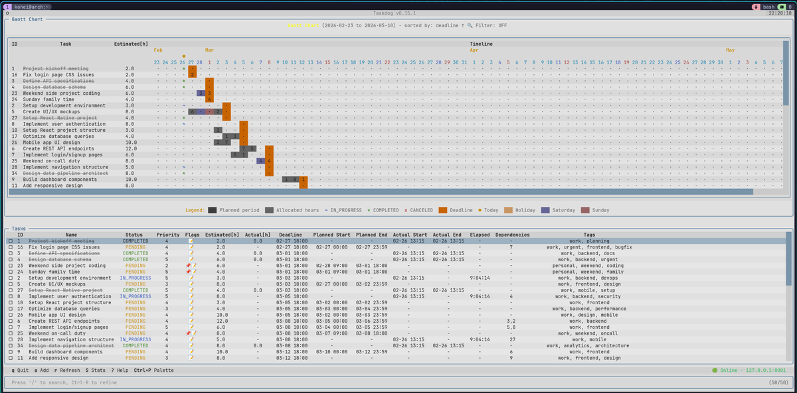

# Taskdog

Taskdog is a terminal task manager for planning work, tracking time, and optimizing schedules. It includes a command-line interface, a full-screen terminal UI, and a REST API backed by local SQLite storage.

This repository is owned by [aienggopal-max](https://github.com/aienggopal-max). It is a copy of [Kohei-Wada/taskdog](https://github.com/Kohei-Wada/taskdog), originally created by Kohei Wada. The imported commit attribution was rewritten for this copy. The upstream repository records the original authors and contributors.



## Install from source

Install Python 3.13 and [uv](https://docs.astral.sh/uv/). Linux and macOS are supported. Use WSL2 on Windows for the supported Linux setup.

```sh
git clone https://github.com/aienggopal-max/taskdog.git
cd taskdog
uv sync --locked --all-packages --python 3.13
```

## Quick start

Start the API server in the checkout and leave it running.

```sh
uv run --no-sync taskdog-server --host 127.0.0.1 --port 8000
```

In a second terminal in the same checkout, add a task and check that it appears in the list.

```sh
uv run --no-sync taskdog add "Plan the weekly review" --priority 10
uv run --no-sync taskdog list --fields id,name,priority,status
```

Run `uv run --no-sync taskdog tui` to open the terminal interface. See the setup guide to configure authentication or install the server as a service.

## Documentation

- [Setup and authentication](docs/getting-started.md)
- [CLI guide](docs/reference/cli-guide.md) and [API guide](docs/reference/api-guide.md)
- [Configuration](docs/configuration.md) and [deployment](contrib/README.md)
- [Schedule optimization](docs/optimization/architecture.md)

## License

Taskdog is distributed under the [MIT License](LICENSE).
